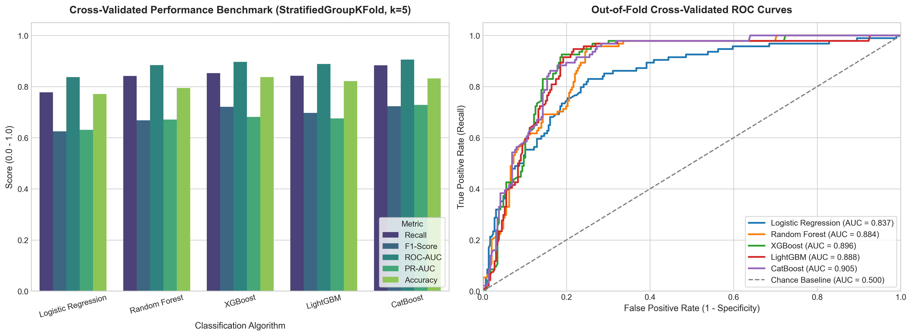
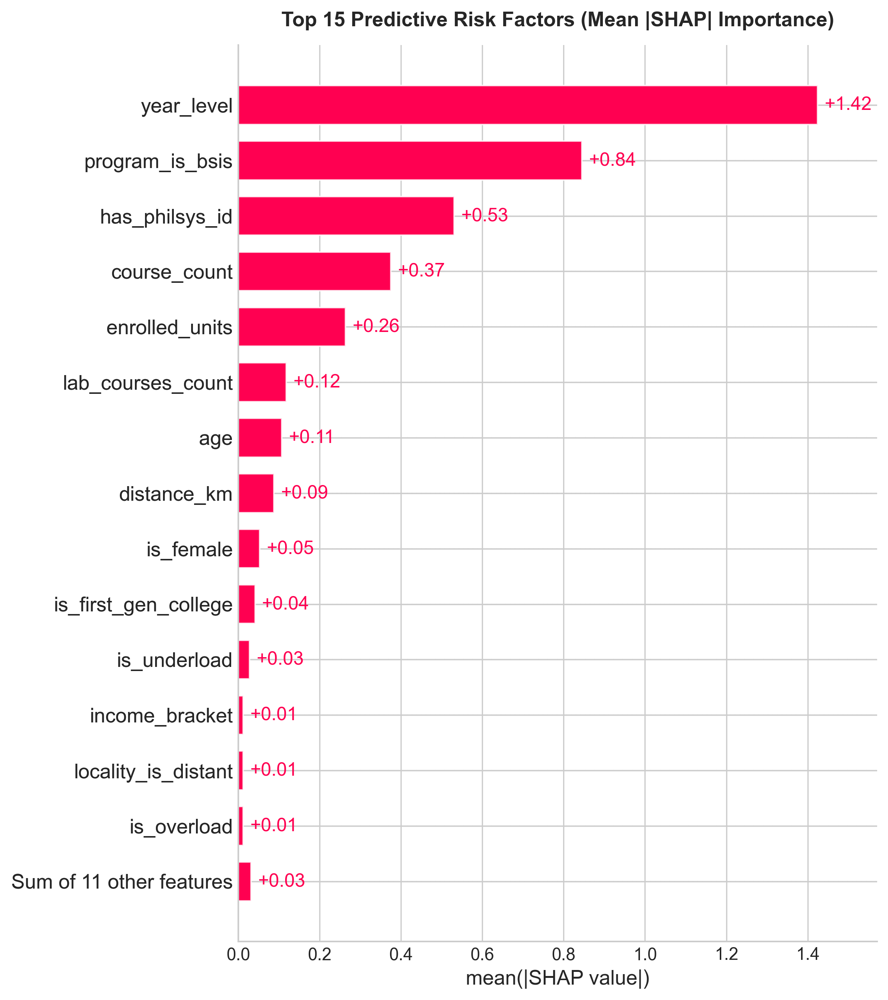
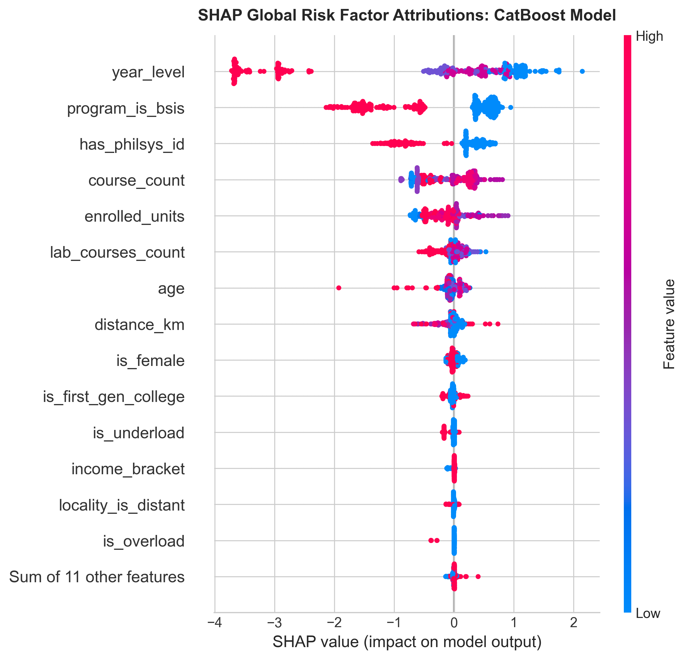
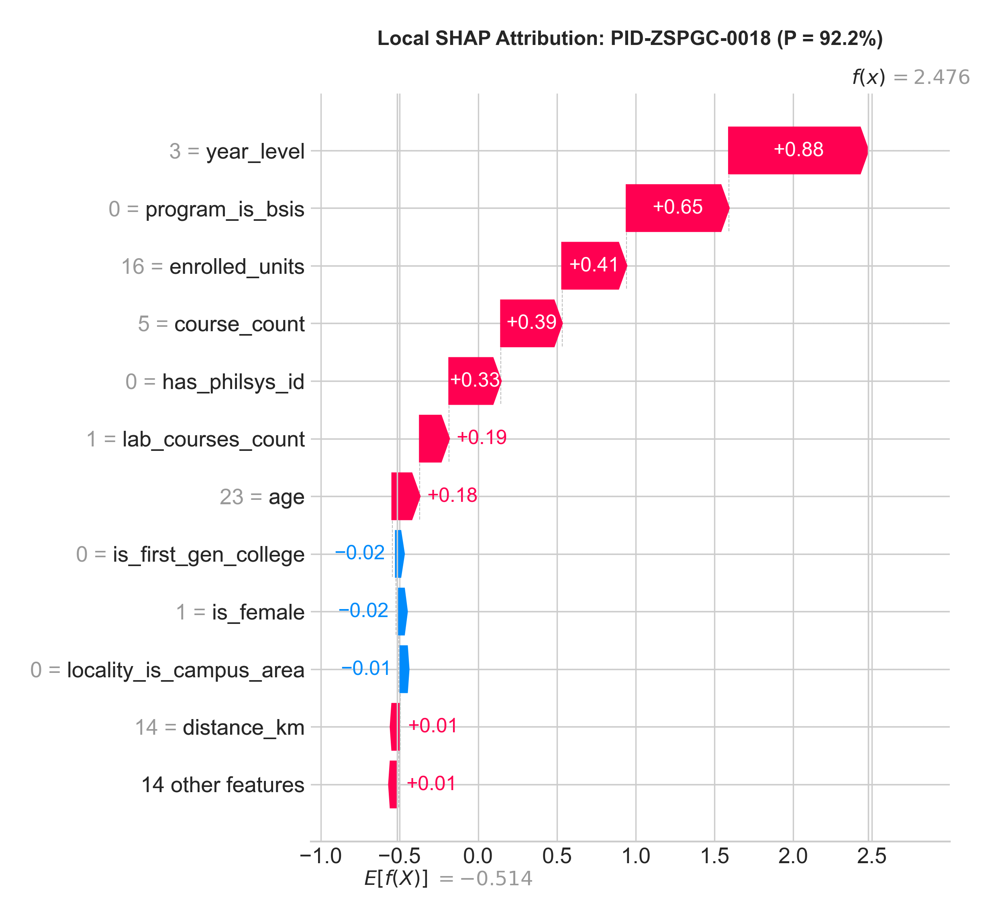
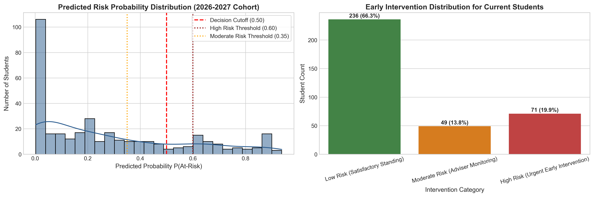
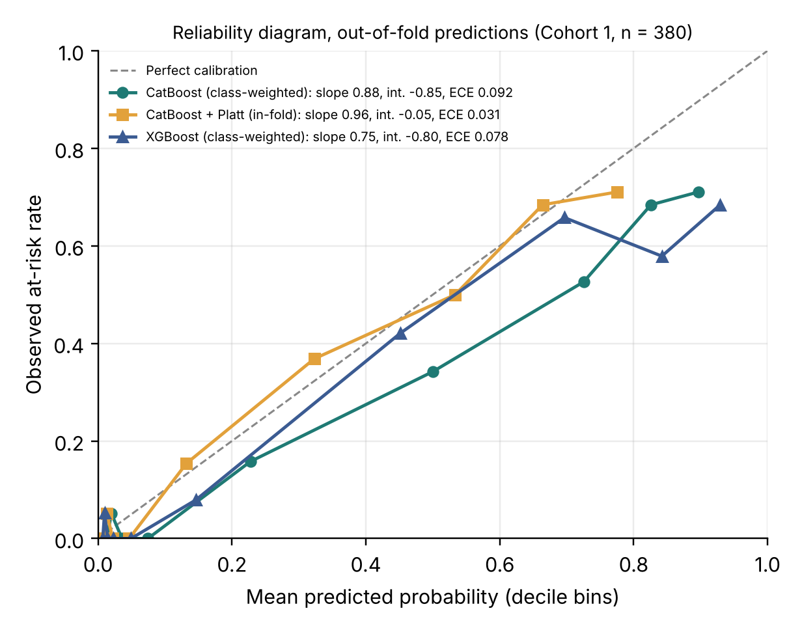

# Reproducibility Package — Early Academic Risk Identification at ZSPGC

Code, specifications, fold assignments, and aggregate results for the article:

> N. P. Gabato Jr., F. Mayol, and J. Delos Arcos, "Evaluating Multi-Source Machine Learning and Explanation Stability for Early Academic Risk Identification in Higher Education."

The study links Registrar enrollment, Registrar grade, and Tertiary Education Subsidy (TES) records from Zamboanga del Sur Provincial Government College (ZSPGC) to estimate, at enrollment (Week 2), each student's risk of an end-of-term academic deficiency (course failure, INC, or dropped course). It benchmarks five classifiers, runs a source-level ablation with repeated grouped cross-validation, evaluates TreeSHAP explanation stability, calibration, alert-capacity detection, and subgroup error rates.

**No student-level data is included.** See [Data access](#data-access).

## Contents

| Path | What it is |
|---|---|
| `cohort_parser.py`, `cleaning_helpers.py`, `build_cleaned_pipeline.py` | Parse the raw institutional spreadsheets, link records on student number, pseudonymize, engineer features, and write the de-identified analysis files |
| `run_ml_experiment.py` | Main experiment: 5-model benchmark (Table II), source ablation (Table III), TreeSHAP and stability (Table IV, Figs. 2–4), alert capacity (Table V), subgroup audit (Table VI), prospective scoring (Fig. 5) |
| `panel_revision_analysis.py` | Repeated 20 × 5-fold paired comparison with Nadeau–Bengio test (Table VII), fixed-capacity detection and cost analysis (Table VIII), learning curve (Table IX), grouped SHAP and permutation importance (Table X), bootstrap and DeLong tests |
| `revision_v4_analysis.py` | Cross-cohort Top-10 Jaccard, extended nested CV including depths 1–2, subgroup bootstrap intervals, Year-4 sensitivity analysis, depth-1 vs. depth-4 comparison |
| `python_engine/train.py`, `python_engine/predict.py` | Training and scoring scripts used by the institutional decision-support prototype |
| `docs/DATA_DICTIONARY.md` | Variable catalogue for every cleaned file |
| `docs/DATA_CLEANING_REPORT.md` | Preprocessing specification: source inventory, linkage, pseudonymization, cleaning rules, target definition |
| `docs/municipality_distance_lookup.csv` | Author-compiled municipality-to-campus road-distance table used for the commuting-distance features |
| `folds/fold_assignments.csv` | Test-fold number (1–5) of every Cohort 1 student for every partition used in the paper |
| `results/*.json` | Aggregate outputs of the revision analyses (no individual records) |
| `figures/*.png` | Publication-ready experimental graphs (Figs. 1–6) including ROC/PR curves, SHAP plots, and calibration diagrams |

## Key Visualizations & Experimental Graphs

The primary experimental graphs generated by the 20-feature leakage-controlled pipeline are provided below and archived in the [`figures/`](figures/) directory:

### Figure 1: 5-Fold Cross-Validated Model Benchmark (ROC and PR Curves)

*Figure 1. 5-fold cross-validated discrimination, sensitivity, and Precision-Recall (PR) curves comparing CatBoost, XGBoost, LightGBM, Random Forest, and Logistic Regression on Cohort 1 ($n = 380$, 94 positive cases).*

---

### Figure 2: Global Feature Importance Ranked by Mean Absolute TreeSHAP (|SHAP|)

*Figure 2. Global predictor importance ranked by mean absolute SHAP value ($|\phi_j|$), showing that academic load (`year_level`, `program_is_bsis`, `course_count`) and TES civil documentation completeness (`has_philsys_id`) dominate model attributions.*

---

### Figure 3: Directional SHAP Beeswarm Summary Distribution

*Figure 3. Directional beeswarm plot illustrating feature impacts on prediction log-odds: lower year level, high enrolled units/courses, and lack of PhilSys national ID in TES records shift risk predictions positively toward academic deficiency.*

---

### Figure 4: Local Explainability — Individual Student Case Waterfall

*Figure 4. Local TreeSHAP waterfall decomposition for high-risk student PID-ZSPGC-0018, demonstrating additive feature contributions shifting baseline log-odds ($E[f(X)] = -0.514$) to an output of $+2.476$ ($P = 92.2\%$ risk).*

---

### Figure 5: Prospective Risk Scoring & Advising Triage Alert Distribution

*Figure 5. Prospective enrollment-time risk scores for S.Y. 2026–2027 Cohort 2 ($n = 356$) stratified into three operational advising triage tiers: High Risk ($P \ge 0.80$), Moderate Risk ($0.50 \le P < 0.80$), and Low Risk ($P < 0.50$).*

---

### Figure 6: Reliability Calibration Diagram and In-Fold Platt Scaling

*Figure 6. Decile reliability diagram of out-of-fold predictions showing that class-weighted models overestimate risk probabilities, while in-fold Platt scaling restores calibration (reducing Expected Calibration Error from 0.092 to 0.031).*

---

## Fold assignments

`folds/fold_assignments.csv` has one row per Cohort 1 student (pseudonymous `student_pid`) and one column per partition seed. All partitions are `StratifiedGroupKFold(n_splits=5, shuffle=True, random_state=seed)` grouped by `student_pid`.

| Seeds | Used for |
|---|---|
| 42 | Reference partition (Tables II–VI, X, XII; Figs. 1–4) |
| 1000–1019 | 20 repeated partitions (Tables VII, VIII); 1000–1009 also for the Year-4 sensitivity and depth-1 vs. depth-4 comparison |
| 2000–2009 | Learning curve (Table IX) |
| 3000–3004 | Outer folds of the extended nested cross-validation |

Partitions depend on the scikit-learn version. The published values were verified with **scikit-learn 1.9.1**; earlier versions produce different splits. With the correct version, the reference partition has 19, 18, 19, 19, and 19 at-risk students in folds 1–5.

## Fixed hyperparameters

| Model | Settings |
|---|---|
| Logistic Regression | L2, C = 0.5, standardized inputs, `class_weight='balanced'` |
| Random Forest | 200 trees, max_depth 6, min_samples_split 4, min_samples_leaf 2, `class_weight='balanced'` |
| XGBoost | 150 estimators, max_depth 4, learning_rate 0.05, subsample 0.8, colsample_bytree 0.8, `scale_pos_weight = 286/94` |
| LightGBM | 150 estimators, num_leaves 15, max_depth 4, learning_rate 0.05, subsample 0.8, colsample_bytree 0.8, `scale_pos_weight = 286/94` |
| CatBoost (reference) | 150 iterations, depth 4, learning_rate 0.05, `auto_class_weights='Balanced'` |

All models use random seed 42 unless a script states otherwise.

## Running

```bash
pip install -r requirements.txt
python build_cleaned_pipeline.py        # needs the raw files in zdspgc-dataset/
python run_ml_experiment.py             # needs cleaned_dataset/student_risk_ml_dataset.csv
python panel_revision_analysis.py
python revision_v4_analysis.py quick    # also: y4, rf, depth1, nested
```

## Data access

The student records are institutional data protected under Republic Act No. 10173 (Data Privacy Act of 2012) and cannot be released publicly. De-identified records are held by ZSPGC and may be made available to qualified researchers on reasonable request, subject to approval by the ZSPGC administration and a data-sharing agreement. The pseudonymization key remains with the ZSPGC Guidance and Scholarship Services Office and is never released.

The `.gitignore` excludes all raw and cleaned data files so they cannot be committed by accident.

## License

Code is released under the MIT License (see `LICENSE`). Documentation and aggregate results may be reused with citation of the article.
